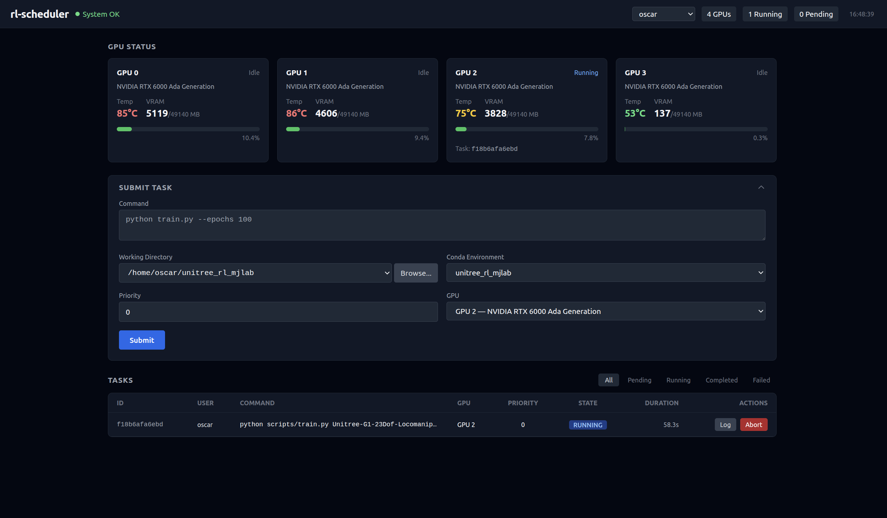

# rl-scheduler

A GPU workload manager that prevents resource contention on multi-GPU machines. It queues ML/RL training jobs and dispatches them to isolated GPUs, ensuring each physical GPU runs exactly one training script at a time.

## Features

- **GPU isolation** via `CUDA_VISIBLE_DEVICES` and `CUDA_DEVICE_ORDER=PCI_BUS_ID` — each job sees only its assigned GPU
- **Priority queue** — higher-priority tasks dispatch first
- **Multi-user aware** — per-user conda environments and working directories
- **Python environment support** — conda and venv, with automatic python binary resolution
- **Manual GPU selection** — pin a task to a specific GPU or let the scheduler auto-assign
- **Persistent queue** — SQLite-backed task state survives server restarts
- **Restart-safe execution** — systemd-managed jobs keep running while the app is closed and are reconciled on restart
- **Live dashboard** — web UI with GPU monitoring, task submission, log viewing, and abort
- **Process group management** — abort kills the entire process tree, not just the parent
- **Live log viewing** — view stdout/stderr while a task is still running
- **Progress tracking** — live progress bars and ETA for rsl_rl-format training logs
- **External process detection** — GPUs show "Busy" when non-scheduler compute processes are running
- **Task management** — delete individual or bulk-delete completed/failed tasks and their logs
- **Task state filters** — filter task table by PENDING/RUNNING/COMPLETED/FAILED
- **GPU fan control** — monitor fan speed/temperature, set manual fan speed or auto mode via the dashboard
- **Admin password** — protect privileged operations (abort/delete in admin mode) with a configurable password

## Screenshots

<p align="center">
  
</p>

## Project Structure

```
rl-scheduler/
├── main.py           # FastAPI app, REST endpoints, static file serving
├── models.py         # Pydantic models, SQLite schema, DB helpers
├── scheduler.py      # Async orchestrator loop, task dispatch, subprocess management
├── hardware.py       # pynvml GPU telemetry and availability checks
├── environments.py   # System-user and Python environment resolution
├── systemd_runner.py # Persistent transient-service execution backend
├── requirements.txt  # Python dependencies
├── requirements-dev.txt # Test dependencies
├── start.sh          # Convenience launcher (sudo python3 main.py)
├── install-service.sh # Install/enable boot startup using the selected Python
├── tests/             # pytest API, database, and scheduler tests
├── static/
│   └── index.html    # Single-page dashboard (Tailwind CSS + vanilla JS)
├── doc/
│   └── dashboard.png # Dashboard screenshot
├── logs/             # Auto-created; per-task stdout/stderr logs
└── scheduler.db      # SQLite database (created at runtime)
```

## Requirements

- Python 3.10+
- NVIDIA GPU with drivers installed
- `nvidia-smi` working (through the `nvidia-ml-py` NVML bindings)
- systemd system manager access (the server normally runs as root)
- conda (optional, only needed if using `conda_env`)

## Installation

```bash
pip install -r requirements.txt
```

For development and tests:

```bash
pip install -r requirements-dev.txt
PYTEST_DISABLE_PLUGIN_AUTOLOAD=1 pytest -q
```

## Usage

Start the server:

```bash
sudo -E python3 main.py
# or: ./start.sh
```

The server runs on `http://0.0.0.0:8000`. Opening this URL in a browser loads the dashboard.

### Start automatically at boot (systemd)

From the installed repository, run:

```bash
# With a writable conda environment:
conda activate your-env
python -I -m pip --isolated install --no-user -r requirements.txt
./install-service.sh
```

The pip command excludes packages from `~/.local` and installs into the selected
environment. It fails rather than falling back to a user installation if that
environment is not writable. Use an environment you own. Without conda, create a
dedicated venv instead of installing dependencies into the system Python:

```bash
python3 -m venv .venv
.venv/bin/python -I -m pip --isolated install --no-user -r requirements.txt
./install-service.sh --python "$PWD/.venv/bin/python"
```

Run the installer as your normal user; it selects `python3` from your current
`PATH` before requesting sudo. You can also select an interpreter explicitly,
including when invoking the installer with sudo:

```bash
./install-service.sh --python /home/your-user/miniconda3/envs/your-env/bin/python
# venvs work too:
./install-service.sh --python /home/your-user/project/.venv/bin/python
```

The installer writes `/etc/systemd/system/rl-scheduler.service`, enables startup
at boot, and starts the app immediately (or restarts it on subsequent runs). Stop
any copy launched manually with `start.sh` or `python main.py` first to free port
8000. Use `--no-start` to install and enable without starting/restarting now, or
`--dry-run` to preview the unit without sudo or system changes.

On first installation, it generates a random admin password in
`/etc/rl-scheduler.env`, owned by root with mode `600`. Existing settings are
preserved on reinstall. View the generated password or edit the settings with:

```bash
sudo cat /etc/rl-scheduler.env
sudoedit /etc/rl-scheduler.env
sudo systemctl restart rl-scheduler
```

This file uses systemd environment-file syntax, for example:

```ini
ADMIN_PASSWORD="replace-with-your-own-secret"
ADMIN_SESSION_TIMEOUT_SECONDS=300
```

The service runs as root for per-user jobs and GPU fan control. Keep the repository
and Python environment writable only by trusted administrators. It uses the
repository as its working directory, so the existing `scheduler.db`, `logs/`, and
dashboard assets continue to be used. Keep both the repository and environment
at their installed paths and available at boot; rerun the installer if either
path changes. Login-unlocked encrypted home directories are unsuitable for boot
startup; use an installation on a filesystem available before login.

The selected environment's Python is invoked directly with its `bin` directory
on `PATH`; boot does not require `conda activate` or a login shell. Conda activation
hooks and variables exported in your terminal are not loaded. If your app needs
additional variables, add them to `/etc/rl-scheduler.env`. The service restarts
after failures, including temporary GPU initialization failures during boot.
The installer checks dependencies in a temporary systemd service using the same
environment settings, including saved `PYTHONPATH` and `LD_LIBRARY_PATH` values.
For a first installation that needs these variables, create the settings file
with `sudoedit /etc/rl-scheduler.env` before running the installer, including
`ADMIN_PASSWORD` and `ADMIN_SESSION_TIMEOUT_SECONDS` as shown above. Settings files
are parsed by systemd, so shell commands and variable substitutions are not run.
See the [systemd service documentation](https://www.freedesktop.org/software/systemd/man/249/systemd.service.html)
for restart and command execution behavior.

```bash
sudo systemctl status rl-scheduler
sudo journalctl -u rl-scheduler -f
curl http://localhost:8000/health

# Stop the app and disable startup at boot:
sudo systemctl disable --now rl-scheduler
```

To uninstall, disable it as above, remove
`/etc/systemd/system/rl-scheduler.service`, then run `sudo systemctl daemon-reload`.
Remove `/etc/rl-scheduler.env` separately if you no longer need its settings.
Stopping the app leaves dispatched task services running; rebooting the device
stops those transient jobs (see [App Restart Recovery](#app-restart-recovery)).

### Quick test via curl

```bash
# Submit a task
curl -X POST http://localhost:8000/tasks/submit \
  -H "Content-Type: application/json" \
  -d '{"username": "your-user", "command": "echo hello && sleep 2", "work_dir": "/tmp"}'

# Check task status
curl http://localhost:8000/tasks/status

# View GPU status
curl http://localhost:8000/gpus
```

## REST API

| Method | Path | Description |
|--------|------|-------------|
| `POST` | `/tasks/submit` | Submit a new task |
| `GET`  | `/tasks/status` | List tasks (`state`, `username`, `q`, `limit`, and `offset` are optional) |
| `POST` | `/tasks/{task_id}/abort` | Force-kill a running or pending task (`username` or `X-Admin-Password`) |
| `GET`  | `/tasks/{task_id}/log` | Get a full log or bounded/incremental output with `tail_bytes` or `offset` |
| `DELETE` | `/tasks` | Delete completed/failed tasks (`username` or `X-Admin-Password`) |
| `DELETE` | `/tasks/{task_id}` | Delete one completed/failed task (`username` or `X-Admin-Password`) |
| `GET`  | `/gpus` | Live GPU telemetry (temp, VRAM, active task, external process count, fan status) |
| `PUT` | `/gpus/{gpu_id}/scheduling` | Enable or disable new task assignments (administrator password required each time) |
| `POST` | `/gpus/{gpu_id}/fan` | Set fan mode and speed (`{"mode": "auto"}` or `{"mode": "manual", "speed": 50}`) |
| `GET`  | `/users` | List system users (uid ≥ 1000 with valid home dir) |
| `GET`  | `/conda/envs/{username}` | List conda environments available to a user |
| `GET`  | `/workdirs/{username}` | List top-level directories in user's home |
| `GET`  | `/workdirs/{username}/browse` | Browse subdirectories in user's home (`?path=`) |
| `GET`  | `/envs/scan-venvs` | Scan a directory for Python venvs (`?path=` and `?username=`) |
| `GET`  | `/health` | System health summary |

### Submit a task

```bash
curl -X POST http://localhost:8000/tasks/submit \
  -H "Content-Type: application/json" \
  -d '{
    "username": "your-user",
    "command": "python train.py --epochs 100",
    "work_dir": "/home/your-user/project",
    "conda_env": "my-env",
    "preferred_gpu_id": 0,
    "priority": 10
  }'
```

Fields:
- `username` **(required)** — the system user to run the command as
- `command` **(required)** — the shell command to execute
- `work_dir` (default: `.`) — working directory for the subprocess
- `env_type` (default: null) — `"conda"` or `"venv"`; selects which resolution strategy to use with `conda_env`
- `conda_env` (default: null) — environment name (conda) or full path (venv); `python`/`python3` in the command is replaced with the env's python binary
- `preferred_gpu_id` (default: null) — pin to a specific GPU, or null for auto-assign
- `priority` (default: 0) — higher values dispatch first

### List tasks

```bash
# All tasks
curl http://localhost:8000/tasks/status

# Filter by state
curl "http://localhost:8000/tasks/status?state=RUNNING"

# Filter by user
curl "http://localhost:8000/tasks/status?username=alice"

# Combined
curl "http://localhost:8000/tasks/status?state=RUNNING&username=alice"
```

### Abort a task

```bash
# Abort by task ID (scoped to a user — no password needed)
curl -X POST "http://localhost:8000/tasks/{task_id}/abort?username=your-user"

# Abort as admin (no user selected — requires admin password)
curl -X POST http://localhost:8000/tasks/{task_id}/abort \
  -H "X-Admin-Password: your-admin-password"
```

### View task logs

```bash
curl http://localhost:8000/tasks/{task_id}/log

# Last 128 KiB (response headers include the next byte offset)
curl "http://localhost:8000/tasks/{task_id}/log?tail_bytes=131072"
```

Works while the task is running — output is streamed to the log file in real time.

## Task Lifecycle

```
PENDING ──claim──> STARTING ──unit active──> RUNNING ──exit 0──> COMPLETED
   │                 │                         │
   └─────────────────┴────abort/failure────────┴──────────────> FAILED
```

- **PENDING** — queued, waiting for a free GPU
- **STARTING** — GPU and systemd unit are assigned and the service is activating
- **RUNNING** — systemd service is active on an assigned GPU
- **COMPLETED** — subprocess exited with code 0
- **FAILED** — subprocess exited with a non-zero code, or was aborted

## GPU Isolation

Each task gets `CUDA_DEVICE_ORDER=PCI_BUS_ID` and `CUDA_VISIBLE_DEVICES=<gpu-index>` injected into its environment. The assigned GPU appears as device 0 to the training script.

A GPU is considered "available" when:
1. Scheduling is enabled for that GPU
2. No scheduler-managed task is currently running on it
3. No non-MPS compute processes are running on it (detected via NVML)

Select a GPU card and use **Disable** under Task scheduling in the GPU control panel to reserve that device for non-compute use. Every enable or disable action requires the administrator password, even when another admin session is active. The setting is stored by PCI bus ID and survives application restarts. Disabled GPUs remain visible for telemetry and fan control, but Auto-select skips them and explicit submissions to them are rejected. Disabling a GPU does not stop its current task; it prevents the next assignment.

GPUs with external compute processes display as "Busy" (yellow), GPUs managed by a scheduler task display as "Running" (blue), and GPUs excluded from scheduling display as "Disabled" (red).

## Python Environment Support

Set `env_type` to `"conda"` or `"venv"` and provide the environment identifier in `conda_env`.

**Conda:** The scheduler locates the target environment's python binary at `/home/<user>/<conda_dir>/envs/<env>/bin/python` (checking anaconda3, miniconda3, and miniforge3). It also reads `~/.conda/environments.txt` for additional env paths. The `base` environment is always available. The command runs under `bash -l` so conda-initialized shell environments are picked up.

**Venv:** `conda_env` should be the full path to the venv directory. The scheduler uses `<conda_env>/bin/python` as the python binary. The path must be within the user's home directory.

## GPU Fan Control

GPU fan speeds are displayed on each GPU card in the dashboard. Clicking a GPU card opens its control panel, which contains scheduling controls and, when supported, automatic/manual fan controls.

Fan control requires root privileges (the server runs with `sudo`) and hardware that supports NVML fan control. Support is detected automatically at runtime; no GPU model configuration is required. GPUs without controllable fans remain available for scheduling and telemetry.

Applying **Auto** enables scheduler temperature control for every fan on that GPU. The controller checks every five seconds, independently of dashboard requests:

| GPU temperature | Fan speed |
| --- | --- |
| Below 50°C | 40% |
| 50–64°C | 60% |
| 65–74°C | 75% |
| 75–79°C | 90% |
| 80°C and above | 100% |

The same default curve applies independently to every supported GPU, with speeds clamped to each GPU's supported range. Heating raises the speed on the next check. Cooling must reach five degrees below a band's threshold and stay there for 30 seconds before lowering the speed. Each downward step requires a separate cooling delay, even if the temperature drops across several bands. For example, after reaching 100% at 80°C, a reading of 79°C keeps the speed at 100%; it drops to 90% only after staying at or below 75°C for 30 seconds. Unchanged targets do not trigger hardware writes.

Manual mode stops scheduler temperature control for that GPU. A temperature-read or fan-write failure triggers a return to driver control. If restoring driver control fails, the controller retries every five seconds until restoration succeeds or a new Auto/Manual setting is successfully applied. On server shutdown, all fans are reset to driver automatic mode. Scheduler Auto selections are not persisted: after a restart, apply Auto again to enable this curve; otherwise automatic control uses the driver's own curve.

```bash
# Set fan to manual at 70%
curl -X POST http://localhost:8000/gpus/0/fan \
  -H "X-Admin-Password: your-admin-password" \
  -H "Content-Type: application/json" \
  -d '{"mode": "manual", "speed": 70}'

# Enable scheduler temperature-based automatic control
curl -X POST http://localhost:8000/gpus/0/fan \
  -H "X-Admin-Password: your-admin-password" \
  -H "Content-Type: application/json" \
  -d '{"mode": "auto"}'
```

## Admin Password

`start.sh` defaults `ADMIN_PASSWORD` to `admin` and the inactivity timeout to five minutes. **Change the default password before running the service on a shared or network-accessible host.** Either edit `start.sh` or override its defaults in the environment:

```bash
export ADMIN_PASSWORD="your-secret"
export ADMIN_SESSION_TIMEOUT_SECONDS=300  # optional; 1-86400
./start.sh
```

When set:
- **User-scoped operations** (selecting a user and managing their own tasks) — no password required
- **Admin mode** (no user selected) — password required for abort, delete, and delete-all
- **Cross-user operations** (managing another user's tasks) — requires admin credentials
- **GPU fan control** — always requires admin credentials

The dashboard exchanges the password at `POST /admin/session` for a random, process-local token. It keeps that token only in browser memory and sends it as `X-Admin-Token`; each successful privileged operation renews the inactivity timeout. Use **Lock** to revoke it immediately. Refreshing the page, restarting the service, or remaining idle past the timeout requires the password again.

Existing API clients may continue sending `X-Admin-Password` or the `admin_password` query parameter. New integrations should create a session and use `X-Admin-Token` so the password is not sent with every operation.

If `ADMIN_PASSWORD` is not set, privileged admin and fan operations return 403 (disabled).

## App Restart Recovery

Each dispatched task runs as `rl-scheduler-task-<task_id>.service`, a transient systemd service with retained exit status. Closing or restarting the web app leaves these units running. On startup, the scheduler restores active GPU registrations, continues log/progress tracking, and records tasks that completed while it was offline. Abort explicitly kills the unit's complete control group.

If systemd cannot be queried, `/health` reports `degraded`, existing task states are preserved, dispatch pauses, and new submissions return HTTP 503. Transient units survive app restarts but not a host reboot.

## TensorBoard

Expand **TensorBoard** after selecting a Linux user. Choose the **Log directory**
with the dropdown, **Browse**, or **Custom** (an absolute path), then select the
Python environment and click **Start TensorBoard**. The selected directory must
exist within the user's home; it can be empty while waiting for training logs.
TensorBoard must already be installed in the environment.

Leave **Port** blank for automatic selection from 6006–6099, or specify a port
from 1024–65535. For example, select `unitree_rl_mjlab`, browse to
`~/unitree_rl_mjlab/logs/rsl_rl/x2_locomanipulation/`, and optionally use port
`6008`. No separate project directory is needed. The dashboard supplies the
selected absolute log directory as both the API's working directory and log path.

**Open** launches TensorBoard in a new browser tab on the dashboard server's
hostname and assigned HTTP port. The port must be reachable through the network
and firewall. TensorBoard binds to `0.0.0.0`; direct access does not inherit the
app's admin access controls. This feature follows the app's existing trusted
user-selection model, which does not authenticate Linux users.

Sessions run as the selected user through systemd, independently of the training
queue, with GPUs hidden. Starting the same user's log directory with the same
interpreter reuses an active session. **Log** opens the same popup viewer as
Tasks, with Copy, Refresh, auto-scroll, and live updates for active sessions. It
shows the last 100 journal lines (at most 64 KiB); use it for missing packages, permissions, or startup
failures. **Stop** ends the service. Sessions stop on app shutdown; leftover
TensorBoard units are cleaned up on the next startup after an abrupt exit.
They are not restored after restart or reboot. Run one app instance per host.
Slow startup does not block stopping other sessions. If the supervisor is
unavailable during startup, a later launch retries availability and orphan
cleanup automatically; transient outages do not require an app restart.
There is no database migration or new app dependency.

API: `POST /tensorboards` accepts `username`, `work_dir`, `log_dir`,
`env_type` (`system`, `conda`, or `venv`), optional `conda_env` (environment name
or venv path), and optional `port`. `GET /tensorboards` lists sessions and accepts
an optional `username` filter. `POST /tensorboards/{id}/stop` and
`GET /tensorboards/{id}/logs` require the owning `username` query parameter or an
existing admin token/password header, following task ownership conventions.

TensorBoard history has no fixed record limit and is held in memory until app
restart. Active sessions stay at the top; stopped/failed records appear newest
first, 10 per page. Previous/Next is always visible while expanded, with
unavailable navigation disabled.

**Delete** appears at the right of every row and removes an individual
stopped/failed record. It is disabled while the session is active. **Delete All**
clears history across all pages for the selected user. Without a selected user, clearing all users' history requires admin access. Running sessions
and training log files are kept. If a failed service could not be stopped, stop
it before clearing its history. The matching API is `DELETE /tensorboards`, with
an optional owning `username` or admin headers. Single-record deletion uses
`DELETE /tensorboards/{id}` with the same authorization rules.
